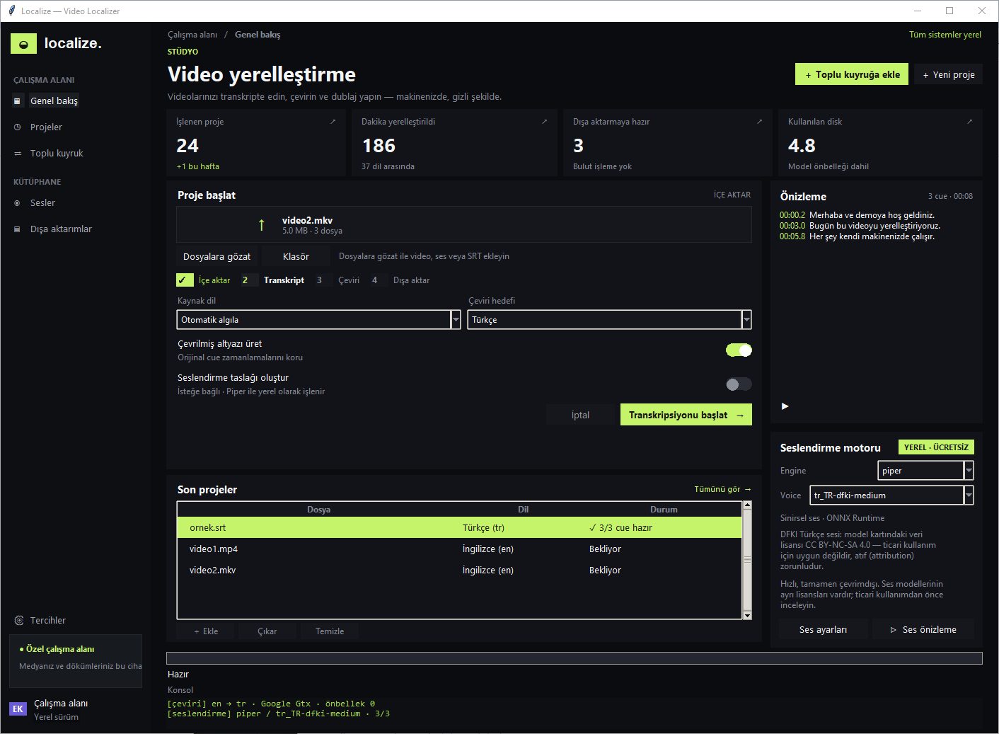
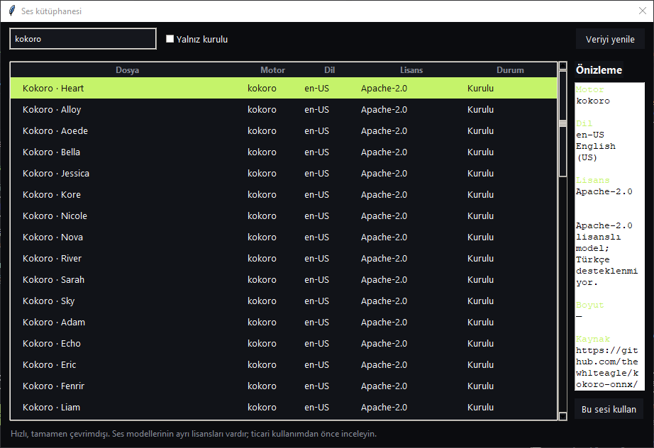
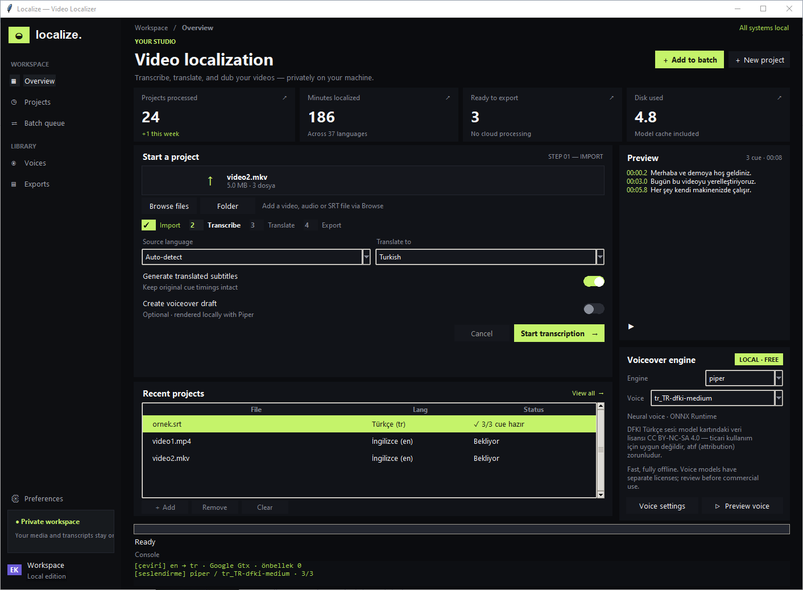

# Localize — Video Localizer

Yerel çalışan masaüstü uygulaması: videoları ve altyazıları farklı dillere yerelleştirin —
transkript edin, çevirin, seslendirin. Her şey makinenizde çalışır; bulut yok.



## Özellikler

| Özellik | Durum |
|---|---|
| SRT okuma/yazma, **zamanlamayı birebir koruma** | ✓ |
| Konuşmayı yazıya çevirme (faster-whisper, tamamen yerel) | ✓ |
| SRT çevirisi (Google doğrudan / deep-translator / **çevrimdışı Argos**) | ✓ |
| Seslendirme motorları: **Piper** (yerel ONNX), **Windows SAPI**, **Kokoro** | ✓ |
| Ses kütüphanesi (178 Piper sesi / 53 dil, **54 Kokoro sesi** / 9 dil, sistem sesleri) | ✓ |
| Seslendirme videoya gömme (ffmpeg varsa) | ✓ |
| Toplu dosya işleme (klasör sürükleme, eşzamanlı iş) | ✓ |
| Çeviri önbelleği (tekrar eden satırlar tekrar çevrilmez) | ✓ |
| Arayüz dili: **Türkçe / English** (Tercihlerden anında geçiş) | ✓ |
| GUI + CLI | ✓ |





## Kurulum

```powershell
pip install -r requirements.txt
```

Tamamen çevrimdışı çeviri için (Argos dil paketleri ilk indirmede ~100-400 MB):

```powershell
pip install argostranslate
argospm install translate-en_tr   # örnek İngilizce -> Türkçe paketi
```

Videoya ses gömmek için `ffmpeg` PATH'te bulunmalı (isteğe bağlı).

## Çalıştırma

### GUI

```powershell
python main.py
```

1. **Dosyalara gözat / Klasör** ile video/ses/SRT dosyaları ekleyin.
2. Kaynak ve hedef dili seçin, işlemleri (çeviri / seslendirme) işaretleyin.
3. **Transkripsiyonu başlat**. Günlük ve ilerleme çubuğu işlemi gösterir; **İptal** her an durdurur.
4. **Ses ayarları** ile ses kütüphanesini açın, **Ses önizleme** ile seçili sesi dinleyin.

### CLI

```powershell
# SRT çevir
python main.py altyazi.srt --target en --out .\cikti

# Video -> metne çevir -> Türkçeye çevir -> SRT yaz
python main.py video.mp4 --target tr --model small

# Toplu: klasördeki tüm video/ses/SRT dosyaları
python main.py .\videolar --target de --out .\cikti --workers 2

# Seslendirme üret (Piper) ve videoya göm
python main.py video.mp4 --target tr --tts --tts-engine piper --embed --model tiny

# Sesi Windows SAPI ile üret
python main.py altyazi.srt --target tr --tts --tts-engine sapi

# Ses kütüphanesini listele
python main.py --list-voices
```

| Seçenek | Açıklama |
|---|---|
| `--target tr` | Hedef dil kodu (varsayılan `tr`) |
| `--source auto` | Kaynak dil; `auto` algılar |
| `--out DIR` | Çıktı klasörü (boş = dosyanın yanında) |
| `--model tiny\|base\|small\|medium\|large-v3` | Whisper model boyutu |
| `--no-translate` | Çeviriyi atla |
| `--no-transcribe` | STT'yi atla, yanındaki `.srt` dosyasını kullan |
| `--ignore-sidecar` | Yanındaki `.srt` dosyasını yok say, yeniden transkript et |
| `--tts` | Seslendirme WAV üret |
| `--tts-engine piper\|sapi\|kokoro` | Seslendirme motoru (varsayılan: piper, yoksa sapi) |
| `--embed` | Seslendirme videoya göm (`*_yerellestirilmis.mp4`) |
| `--workers N` | Eşzamanlı iş sayısı |
| `--voice` / `--rate` | TTS ses kimliği / konuşma hızı |
| `--list-voices` | Ses kütüphanesini listele ve çık |

## Ses motorları ve lisansları

| Motor | Kaynak | Lisans | Not |
|---|---|---|---|
| **Piper** | [rhasspy/piper-voices](https://huggingface.co/rhasspy/piper-voices) | Modele göre; **tr_TR-dfki-medium: CC BY-NC-SA 4.0** | Yerel ONNX; TR sesi **ticari kullanıma uygun değil**, atıf zorunlu |
| **Windows SAPI** | Sistem sesleri | İşletim sistemi lisansı | `pyttsx3` ile, indirme gerektirmez |
| **Kokoro** | [thewh1teagle/kokoro-onnx](https://github.com/thewh1teagle/kokoro-onnx) | Apache-2.0 | **54 ses / 9 dil** (en-US, en-GB, es, fr, hi, it, ja, pt-BR, zh); **Türkçe yok** |
| **Common Voice (Türkçe)** | [Mozilla Common Voice](https://commonvoice.mozilla.org/tr) | CC0 / CC-BY (veri seti) | Hazır seslendirme değil, **konuşma veri kümesi** |

> Ses modellerinin lisansları birbirinden farklıdır; ticari kullanımdan önce model
> lisansını inceleyin. Uygulamanın kendisi MIT lisanslıdır (bkz. `LICENSE`).

## İşlem hattı

```
video/mp3/srt
   │  (videoysa ve yan .srt yoksa)
   ├─ STT: faster-whisper  → cue'lar (başlangıç/bitiş ms korunur)
   ├─ Çeviri: Google doğrudan (bağımlılıksız) / deep-translator / Argos (çevrimdışı)
   │          satır sarmalama orijinal biçime göre yapılır, ZAMANLAMAYA DOKUNULMAZ
   ├─ Yazma: <ad>.<dil>.srt   (UTF-8)
   └─ TTS (isteğe bağlı): Piper / SAPI / Kokoro → parçalar → stdlib `wave` ile
      zaman çizelgesine yerleştirilmiş <ad>.<dil>.wav
      + ffmpeg varsa <ad>.<dil>_yerellestirilmis.mp4
```

## Mimari

```
main.py                 GUI/CLI giriş noktası
videoloc/
  srt.py                SRT ayrıştırıcı/yazıcı, zaman damgası, satır sarma
  langs.py              Dil adı <-> kod sözlüğü
  translate.py          Çeviri motorları (Gtx/Argos/deep-translator), önbellek, rewrap
  transcribe.py         faster-whisper sarmalayıcı, ilerleme, PyAV uyumluluk yaması
  tts.py                Piper/SAPI/Kokoro sentez, WAV zaman çizelgesi, ffmpeg mux
  voices.py             Ses kütüphanesi: Piper katalog, indirme, lisanslar
  i18n.py               TR/EN arayüz metinleri
  dialogs.py            Ses kütüphanesi ve Tercihler pencereleri
  batch.py              İş modeli, toplu çalıştırma, iptal, önbellek diske yazma
  gui.py                Tkinter arayüzü (iş parçacığı + kuyruk üzerinden olaylar)
  cli.py                argparse CLI
tools/
  make_screenshots.py   Ekran görüntülerini üretir (Pillow)
tests/                  43 birim/entegrasyon testi
```

## Testler

```powershell
python -m pytest tests -q
python -m ruff check .
```

Ekran görüntülerini yeniden üretmek için:

```powershell
python tools/make_screenshots.py
```

## Sınırlar / notlar

- İlk STT kullanımında Whisper modeli otomatik indirilir (tiny ~75 MB, small ~484 MB).
- Google çevirisinde hız sınırı olabilir; uygulama otomatik geri çekilme (retry) yapar.
  Çevrimdışı garanti istiyorsanız `argostranslate` kurup dil paketini indirin.
- Piper TR sesi (`tr_TR-dfki-medium`, ~63 MB) ilk kullanımda otomatik indirilir;
  Kokoro modelleri (~134 MB) **Ses ayarları** penceresinden bir kez indirilir.
- Kokoro Türkçe desteklemez; Türkçe seslendirme için Piper veya SAPI kullanın.
  Kokoro'nun 54 sesi 9 dilde çalışır ve ses kütüphanesinde listelenir.
- Zamanlama asla değiştirilmez; uzun satırlar aynı süre içinde alt satıra bölünür,
  çok uzun altyazılar orantılı olarak iki cue'a ayrılır (toplam süre korunur).
